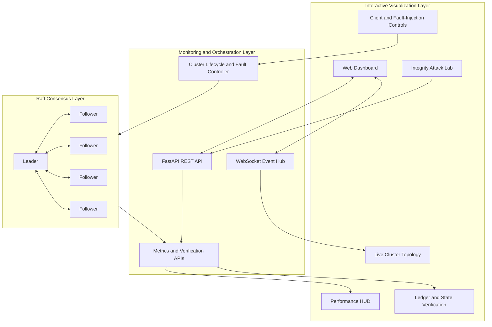

# ConsensusCraft

### An Interactive Distributed Systems Laboratory for Raft Consensus, Fault Injection, and Independent Consistency Verification

**Explore consensus. Inject failures. Verify consistency. Observe recovery.**

ConsensusCraft is an interactive distributed-systems laboratory that makes the behavior of the **Raft consensus algorithm** visible and testable. Through a real-time web dashboard, users can observe leader elections, log replication, node failures, network partitions, recovery, and the consistency of replicated state.

Instead of treating consensus as a black box, ConsensusCraft lets users experiment with cluster failures and inspect the resulting logs, metrics, and verification results.

The project combines a Python-based Raft implementation, a FastAPI backend, a real-time frontend, performance monitoring, independent state verification, and an Integrity Attack Lab in one interactive environment.

---

## Table of Contents

* [Why ConsensusCraft?](#-why-consensuscraft)
* [Key Features](#-key-features)
* [How It Works](#-how-it-works)
* [System Architecture](#-system-architecture)
* [Technology Stack](#-technology-stack)
* [Getting Started](#-getting-started)
* [Exploring the Dashboard](#-exploring-the-dashboard)
* [Running the Tests](#-running-the-tests)
* [API Reference](#-api-reference)
* [Example Experiments](#-example-experiments)
* [Potential Applications](#-potential-applications)
* [Scope and Limitations](#-scope-and-limitations)
* [References](#-references)

---

## 💡 Why ConsensusCraft?

Distributed systems must continue coordinating when individual nodes fail, communication is interrupted, or replicas temporarily fall behind.

Understanding these situations requires more than observing a successful request. Developers also need to understand:

* How a leader is elected.
* Why a minority partition cannot commit new entries independently.
* How committed log entries are replicated.
* What happens when the current leader fails.
* How replicas recover after connectivity returns.
* Whether replicated nodes agree on their committed histories and application state.
* How integrity checks respond when data is modified unexpectedly.

ConsensusCraft provides an interactive environment for investigating these questions.

It connects **consensus behavior, controlled failures, performance measurements, and independent verification** so that users can examine what the cluster actually does rather than relying only on a visual representation.

## ✨ Key Features

### 1. 🔄 Raft Consensus Engine

Explore the core mechanisms of a Raft-based distributed system.

* Asynchronous Python implementation using `asyncio`.
* Leader election with randomized election timeouts.
* Leader heartbeats and log replication.
* Majority-quorum-based commitment.
* Log consistency checks and follower catch-up.
* State-machine application of committed entries.
* Leader replacement following node failure.

The five-node configuration provides a practical environment for observing quorum behavior and experimenting with failures.

### 2. 🌐 Interactive Cluster Visualization

Observe the cluster through a web-based dashboard.

* Live visualization of the Raft topology.
* Node roles, terms, and commit indices.
* Node selection and individual node controls.
* Cluster-state inspection and system logs.
* Client terminal for key-value operations.
* Network-partition and recovery controls.
* Performance and consistency information.

The dashboard helps connect events such as a leader failure or network partition to changes in the underlying cluster.

### 3. 🧪 Fault Injection and Recovery

Introduce failures and observe how the cluster responds.

Available experiment categories include:

* Killing and reviving nodes.
* Removing the active leader.
* Observing replacement leader elections.
* Creating a 3–2 network partition.
* Healing network partitions.
* Inspecting replication lag and recovery behavior.
* Checking consistency before, during, and after failures.

A central experiment is the five-node 3–2 partition.

Three nodes form a majority and can establish a quorum, while two isolated nodes cannot independently commit new entries without obtaining a majority.

The dashboard allows users to observe this behavior and inspect the resulting cluster state.

### 4. ⚡ Consensus Performance Monitoring

ConsensusCraft includes a performance HUD for examining how the cluster responds to operations and leadership changes.

The metrics include:

* Throughput, measured in transactions per second.
* Average command latency.
* Last measured command latency.
* Number of committed transactions.
* Failed submission count.
* Leader failover time.

These measurements help users investigate the performance impact of client operations, failures, and elections.

Metrics are observations of the current implementation and workload, not universal performance guarantees.

### 5. 🔗 Committed-Ledger Consistency Verification

Two nodes can have similar application states without necessarily having identical committed histories.

ConsensusCraft includes a verification mechanism that examines committed log histories across nodes.

The ledger verifier uses canonicalized committed entries and SHA-256 hash chains to compare committed histories.

It can identify conditions such as:

* Consistent committed histories.
* Nodes that are behind a reference history.
* Divergent committed histories.
* Unavailable nodes.
* Verification errors.

This helps distinguish a node that is merely behind from one whose committed history differs from the reference.

### 6. 🧠 Independent State-Transition Verification

ConsensusCraft also checks whether the application state produced by committed operations matches an independently reconstructed state.

Rather than trusting a node's live key-value store to determine the expected result, the verifier replays committed log entries from an initial state and compares the reconstructed state with the node's applied state.

The verification includes:

* Independent replay of committed operations.
* Canonical state fingerprints using SHA-256.
* Comparison at each node's applied index.
* Separate tracking of commit lag and application lag.
* Detection of differences between expected and actual state.
* Handling of unavailable nodes and verification errors.

**Why are both verification systems useful?**

Ledger verification examines whether nodes agree on committed histories. State verification examines whether applying those committed operations produces the expected application state.

These checks answer different questions and provide complementary views of consistency.

### 7. 🛡️ Integrity Attack Lab

The Integrity Attack Lab provides an environment for stimulating data-tampering scenarios and examining the resulting integrity-verification behavior.

It helps users investigate questions such as:

* What happens when stored data is modified unexpectedly?
* Can the verification mechanism identify a discrepancy?
* Does the observed state match the independently reconstructed state?
* What do the verification results report after the experiment?

The lab is intended to make integrity-related failure scenarios observable and testable.

Its results should be interpreted using the actual tampering experiment and verification output. Detecting a discrepancy does not, by itself, prove that tampering was prevented or that every possible attack can be detected.

**Important:** Integrity verification is a separate capability from Raft consensus. It does not make the underlying Raft protocol Byzantine fault-tolerant.

---

## 🏗️ How It Works

At a high level, ConsensusCraft combines a distributed consensus engine with monitoring, visualization, and verification components.

### Normal operation

1. The cluster starts its nodes.
2. A leader is elected through the Raft election process.
3. A client submits a command.
4. The leader coordinates replication with followers.
5. The command is committed when the required quorum conditions are satisfied.
6. Committed entries are applied to the state machine.
7. Monitoring and verification components expose information about the resulting cluster state.

### When failures occur

1. A node or communication path is disrupted.
2. The cluster's ability to communicate changes.
3. The remaining connected nodes attempt to maintain or establish leadership.
4. Commit operations depend on the availability of a quorum.
5. Once connectivity returns, replicas can catch up through the implementation's replication and recovery mechanisms.
6. The dashboard and verification systems allow users to inspect the resulting state.

The actual behavior depends on the experiment, current cluster state, election timing, and implementation details.

---

## 🏛️ System Architecture

ConsensusCraft is organized into three principal layers.



### Frontend — Visualization Layer

The frontend uses HTML, CSS, and JavaScript to display the cluster topology, node information, performance metrics, verification results, and experiment controls.

### Backend — Monitoring and Orchestration Layer

`monitor.py` provides the FastAPI application, REST endpoints, WebSocket communication, and cluster-control integration.

It connects the dashboard to the underlying Raft implementation and its monitoring components.

### Raft — Consensus Layer

The `raft/` package contains the consensus implementation, including node behavior, state models, RPC communication, and verification components.

The backend exposes the information needed to observe and investigate cluster behavior.

---

## 🛠️ Technology Stack

| Component               | Technology                       |
| ----------------------- | -------------------------------- |
| Programming language    | Python                           |
| Asynchronous execution  | `asyncio`                        |
| Backend API             | FastAPI                          |
| Real-time communication | WebSockets                       |
| Frontend                | HTML, CSS, JavaScript            |
| Consensus algorithm     | Raft                             |
| Ledger verification     | SHA-256 hash chains              |
| State verification      | Independent committed-log replay |
| Automated testing       | `pytest`                         |

---

## 🚀 Getting Started

### Prerequisites

Install the following:

* Python 3.10 or newer.
* Git.
* A modern web browser.

The project has been developed and tested with Python 3.12.

### 1. Clone the repository

```bash
git clone https://github.com/Wizard52007/INNOVISE-2026.git
cd INNOVISE-2026
```

### 2. Create a virtual environment

**Windows — PowerShell**

```powershell
python -m venv .venv
.\.venv\Scripts\Activate.ps1
```

**Linux/macOS**

```bash
python3 -m venv .venv
source .venv/bin/activate
```

### 3. Install dependencies

```bash
python -m pip install -r requirements.txt
```

### 4. Start the application

From the repository root:

```bash
python monitor.py
```

If your environment already contains the project's virtual environment, you can run the application directly on Windows with:

```powershell
.\.venv\Scripts\python.exe monitor.py
```

The default development server uses port `8000`. If that port is already occupied, check whether another instance of the application is running before starting a second instance.

### 5. Open the dashboard

Navigate to:

**http://localhost:8000**

Wait for the cluster to initialize and observe the leader-election process.

From the dashboard, explore the available client operations, node controls, fault-injection experiments, performance metrics, and verification panels.

---

## 🖥️ Exploring the Dashboard

For a first-time walkthrough, use the following sequence.

### Step 1 — Observe a healthy cluster

* Wait for a leader to be elected.
* Inspect the roles and terms of the nodes.
* Observe the current commit index.

### Step 2 — Submit a client operation

* Submit a supported key-value command.
* Observe the command response.
* Inspect the log and commit-index changes.
* Check the resulting state across the nodes.

A successful HTTP response alone should not be treated as proof that an operation was committed. Inspect the committed state and relevant verification results.

### Step 3 — Simulate leader failure

* Identify the current leader.
* Use the available node controls to stop it.
* Observe the election process.
* Confirm that another leader is selected when the remaining nodes can establish a quorum.
* Inspect the cluster after it stabilizes.

### Step 4 — Experiment with a network partition

* Create a 3–2 partition.
* Identify the majority and minority groups.
* Observe leader-election behavior.
* Examine whether writes can be committed by the majority.
* Verify that the minority cannot independently commit writes without a quorum.

### Step 5 — Heal the partition

* Restore connectivity.
* Observe replication and recovery.
* Ch
