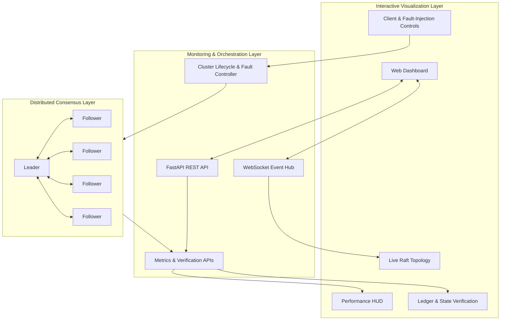

# ConsensusLab

### Distributed Raft Consensus Engine, Real-Time Visualization & Independent Consistency Verification

ConsensusLab is an interactive distributed systems laboratory built around the **Raft consensus algorithm**. It allows users to observe leader election, log replication, node failures, network partitions, and recovery through a real-time dashboard.

Beyond visualizing consensus, ConsensusLab provides performance monitoring, committed-ledger consistency verification, and independent state-machine verification to help users understand what happens inside a distributed system during normal operation and failures.

**Explore consensus. Inject failures. Verify consistency. Observe recovery.**

---

## ✨ Key Features

### 🔄 Raft Consensus Engine

* Asynchronous Python implementation using `asyncio`.
* Leader election with randomized election timeouts.
* Leader heartbeats and log replication.
* Majority-quorum-based commitment.
* Log consistency checks and follower catch-up.
* State-machine application of committed entries.

### 🌐 Interactive Cluster Visualization

* Real-time visualization of the Raft cluster.
* Live node roles, terms, and commit indices.
* Node selection and individual node controls.
* Live system logs and cluster-state inspection.
* Client terminal for key-value operations.
* Dynamic node addition through the existing cluster controls.

### ⚡ Performance Monitoring

Monitor the cluster's behavior through a dedicated performance HUD.

* Throughput in transactions per second.
* Average and last measured command latency.
* Committed transaction count.
* Failed submission count.
* Leader failover time.

These metrics help users observe the performance implications of client operations and leadership changes.

### 🔍 Committed-Ledger Consistency Verification

ConsensusLab independently examines committed histories across cluster nodes.

The verification system uses canonicalized committed entries and SHA-256 hash chains to compare ledger prefixes.

It can identify conditions such as:

* Consistent committed histories.
* Nodes that are behind the reference history.
* Divergent committed histories.
* Nodes that are unavailable or encounter verification errors.

This helps distinguish a node that is merely behind from one whose committed history differs from the reference.

### 🧠 Independent State-Transition Verification

ConsensusLab also verifies the state produced by committed operations.

Rather than using a node's live key-value store to construct the expected state, the verifier independently replays committed log entries from an initial state and compares the reconstructed result with each node's applied state.

The verification includes:

* Canonical state fingerprints using SHA-256.
* Comparison at each node's applied index.
* Separate tracking of commit lag and application lag.
* Detection of differences between expected and actual state.
* Explicit handling of unavailable nodes and verification errors.

**Why two verification systems?**

Matching final key-value states does not necessarily prove that committed histories match. Ledger verification examines committed history, while state verification examines the state reconstructed from committed operations.

Together, they provide complementary views of distributed consistency.

### 🧪 Fault Injection & Recovery Experiments

Experiment with failures and observe how the cluster responds.

* Kill and revive nodes.
* Isolate the active leader.
* Create a 3/2 network partition in a five-node cluster.
* Heal network partitions.
* Observe elections, replication lag, and recovery.
* Inspect consistency statuses before, during, and after failures.

These controls make it possible to investigate majority-quorum behavior, node recovery, and convergence after connectivity is restored.

---

## 🏗️ System Architecture

ConsensusLab is organized into three main layers.



### 1. Interactive Frontend

The HTML, CSS, and JavaScript frontend renders the cluster topology, node information, performance metrics, verification results, and fault-injection controls.

### 2. Monitoring & Orchestration

`monitor.py` provides the FastAPI application, REST endpoints, WebSocket communication, and cluster-control integration.

### 3. Raft Consensus Core

The `raft/` package contains the distributed consensus implementation, including node behavior, state models, RPC communication, and the independent verification components.

---

## 🛠️ Technology Stack

| Component               | Technology                       |
| ----------------------- | -------------------------------- |
| Programming language    | Python                           |
| Asynchronous execution  | `asyncio`                        |
| Backend API             | FastAPI                          |
| Real-time communication | WebSockets                       |
| Frontend                | HTML, CSS, JavaScript            |
| Consensus algorithm     | Raft                             |
| Ledger verification     | SHA-256 hash chains              |
| State verification      | Independent committed-log replay |
| Automated testing       | pytest                           |

---

## 🚀 Getting Started

### Prerequisites

* Python 3.10 or newer.
* Git.
* A modern web browser.

### 1. Clone the repository

```bash
git clone https://github.com/Wizard52007/INNOVISE-2026.git
cd INNOVISE-2026
```

### 2. Create a virtual environment

**Windows PowerShell:**

```powershell
python -m venv .venv
.\.venv\Scripts\Activate.ps1
```

**Linux/macOS:**

```bash
python3 -m venv .venv
source .venv/bin/activate
```

### 3. Install dependencies

```bash
python -m pip install -r requirements.txt
```

### 4. Start the application

```bash
python monitor.py
```

### 5. Open the dashboard

Navigate to:

**http://localhost:8000**

From the dashboard, you can inspect the cluster, submit key-value commands, view performance metrics, and experiment with node failures and network partitions.

---

## 📡 API Endpoints

The following monitoring endpoints expose performance and consistency information.

| Endpoint                      | Purpose                                         |
| ----------------------------- | ----------------------------------------------- |
| `GET /api/metrics`            | Retrieve consensus performance metrics          |
| `GET /api/ledger/consistency` | Retrieve committed-ledger consistency results   |
| `GET /api/state/verification` | Retrieve independent state-verification results |

The dashboard also uses the application's existing REST and WebSocket interfaces for cluster visualization, client operations, and fault-injection controls.

---

## 🧪 Running the Tests

Run the complete automated test suite from the repository root:

```bash
python -m pytest tests/ -v
```

The suite covers the existing Raft implementation, including state-machine behavior, RPC communication, elections, replication, safety, monitoring, performance metrics, committed-ledger consistency, and independent state verification.

The current development version has reported **76 passing tests**. Run the command above against your checked-out revision to reproduce the result.

---

## 🔬 Example Experiments

### Experiment 1: Client Write

1. Start the cluster and wait for a leader to be elected.
2. Submit a key-value command through the client terminal.
3. Observe replication and commit-index changes.
4. Inspect the global state and verification panels.

### Experiment 2: Leader Failure

1. Select the current leader.
2. Kill the node.
3. Observe the remaining nodes elect a replacement leader.
4. Check whether previously committed data remains available.
5. Verify the cluster after it stabilizes.

### Experiment 3: Network Partition

1. Create a 3/2 partition in a five-node cluster.
2. Observe the majority and minority groups.
3. Monitor commit indices and verification statuses.
4. Heal the network.
5. Check whether the nodes converge on the same committed history and state.

The results depend on the actual cluster state and should be confirmed through the dashboard and verification APIs.

---

## 📊 What Makes ConsensusLab Different?

ConsensusLab combines three complementary capabilities:

| Capability                     | Question it answers                                                         |
| ------------------------------ | --------------------------------------------------------------------------- |
| Performance monitoring         | How is the cluster performing?                                              |
| Committed-ledger verification  | Do nodes agree on their committed histories?                                |
| Independent state verification | Does each node's applied state match the independently reconstructed state? |

The fault-injection controls make it possible to observe these properties under changing network and node conditions rather than examining only healthy operation.

The project is intended as an interactive environment for exploring distributed consensus, monitoring behavior, and verifying consistency.

---

## ⚠️ Scope & Limitations

* ConsensusLab implements and visualizes Raft-based consensus behavior; it is not a Byzantine fault-tolerant consensus system.
* Verification reports consistency and discrepancies; it does not automatically repair divergent state.
* Results reflect the implementation's current verification model and available log/state information.
* Network-partition experiments should be interpreted using actual commit indices, API results, and recovery behavior.
* Verification over the current in-memory log does not imply support for arbitrary log compaction or snapshot-based verification.

---

## 📚 References

* Ongaro, D., and Ousterhout, J. **In Search of an Understandable Consensus Algorithm.** USENIX Annual Technical Conference, 2014.
* [The Raft Consensus Algorithm](https://raft.github.io/)
* [The Raft Paper (PDF)](https://raft.github.io/raft.pdf)

---

## 📄 License

This project is distributed under the MIT License. See the repository's license file for details.

The project builds upon the existing Raft implementation in the upstream repository. Preserve the original license and attribution notices.
